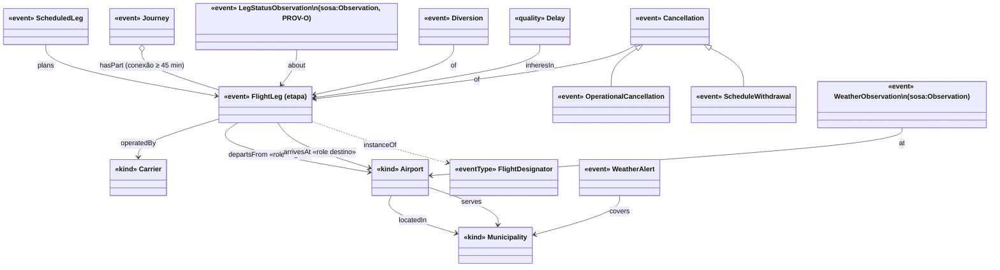

# Modelo conceitual — voos2026 (Nível 1)

Modelo explícito do domínio em OntoUML/gUFO. Os nomes das classes são o schema dos marts; as
definições abaixo são as que valem na página de metodologia. Objetivo: separar o que as fontes
realmente afirmam (uma etapa, um status observado por alguém em um instante) do que a análise
quer medir (uma viagem, um cancelamento), e tornar a proveniência parte do dado.

Vocabulários externos reaproveitados nos nomes de propriedade: **NASA ATM ontology (atmonto)**
(`scheduledOffBlockTime`, `actualOffBlockTime`, `flightStatus`, `cancelled`, `flightDepDelayMin`,
`departureDelayCode`), **schema.org/Flight**, **PROV-O** (`prov:wasDerivedFrom`, `prov:generatedAtTime`,
`prov:Agent`), **SOSA/SSN** (`sosa:Observation`, `sosa:FeatureOfInterest`). A ontologia ICARUS foi
avaliada e descartada como espinha dorsal (metadados de plataforma; a camada de aviação dela é a
própria atmonto).

## Classes

| Classe | gUFO | Definição operacional | Identidade / chave | Fontes |
|---|---|---|---|---|
| `Carrier` | `gufo:Kind` | Empresa aérea **operadora** de uma etapa. Codeshares (marketing) não criam instâncias. | ICAO 3 letras (`GLO`, `AZU`, `TAM`); IATA só como alias (`data/ref/carriers.csv`) | VRA, SIROS, Fraport |
| `Airport` | `gufo:Kind` | Aeródromo público. Os papéis **origem** e **destino** são `gufo:Role` que o aeroporto desempenha *em uma etapa* (relator = a etapa). | ICAO 4 letras; IATA alias (OurAirports `local_code` = CIAD ANAC) | ANAC, OurAirports |
| `Municipality` | `gufo:Kind` | Município IBGE. Duas relações com `Airport`: `locatedIn` (onde o aeródromo fica) e `serves` (município servido, ANAC). **O perfil eleitoral é qualidade do município**, nunca do aeroporto. | código IBGE 7 dígitos (TSE 5 dígitos via crosswalk oficial) | ANAC, IBGE, TSE |
| `FlightDesignator` | tipo de alta ordem (`gufo:EventType`) | "G3 1979": a série de voos de uma companhia sob um número. Instancia `FlightLeg`. Pode mudar de rota/horário ao longo do tempo. | `carrier_icao` + número normalizado | SIROS, VRA |
| `ScheduledLeg` | `gufo:Event` (planejado) | Registro de uma etapa na malha (SIROS: `Nº SIROS`, `Data Registro`, início/fim de operação, dias da semana). Pode ser **retirado** sem jamais virar um cancelamento. | `flight_key` + `snapshot_date` | SIROS diário |
| `FlightLeg` (etapa) | `gufo:Event` | Voo de um aeroporto a outro em uma data, com partida prevista original. **É o grão do VRA e do painel da Fraport.** | `flight_key = {carrier}-{nº 4 dígitos}-{origem}-{partida prevista original UTC}` | VRA, Fraport |
| `Journey` | `gufo:Event` composto (`gufo:hasPart`) | Itinerário origem → destino final com uma ou mais etapas e conexão mínima de 45 min no mesmo dia local. **"POA → Nordeste" como viagem é `Journey`, não `FlightLeg`.** | derivado (etapas + janela de conexão) | derivado |
| `LegStatusObservation` | `gufo:Event` / `sosa:Observation` | Afirmação de **uma fonte**, em **um instante**, sobre o status de uma etapa: `source`, `fetched_at`, `etag`, `status_raw`, `status_canon`, `event_class`, `status_kind`, `confidence`. PROV-O: `prov:wasDerivedFrom` (snapshot), `prov:generatedAtTime` (`fetched_at`). | `flight_key` + `source` + `fetched_at` | todas |
| `Cancellation` | `gufo:Event` | Etapa prevista não realizada. Subtipos: **`OperationalCancellation`** (declarada no dia; VRA `CANCELADO` = oficial, Res. ANAC 218/2012 "etapa básica prevista não realizada"; Fraport `Cancelado` = provisório) e **`ScheduleWithdrawal`** (trecho presente em snapshot anterior da malha e ausente no do dia — nunca aparece como CANCELADO em nenhuma fonte). | `flight_key` | VRA, Fraport, SIROS (diff) |
| `Diversion` | `gufo:Event` | Etapa que pousou em aeródromo diferente do destino (`Alternado`). | `flight_key` | Fraport, VRA (destino real ≠ previsto) |
| `Delay` | `gufo:Quality` da etapa | `delay_min = actual_or_estimated − scheduled_original`, em minutos; derivados A15/A30/A60. O VRA só dá bins (`Pontual` ≤ 30 min!), por isso o atraso é recalculado dos timestamps. | — | VRA, Fraport |
| `WeatherObservation` | `gufo:Event` / `sosa:Observation` | METAR/SPECI de um `Airport` em um instante (UTC): visibilidade, teto, fenômenos, vento/rajada. Qualidades derivadas: `imc`, `red`, `below_cat1`, `convective`, `gusty`, `severity` 0–3. | `icao` + `valid_utc` | IEM/DECEA, REDEMET |
| `WeatherAlert` | `gufo:Event` | Aviso meteorológico INMET com severidade, período e geocodes de municípios. | `id` INMET | INMET |

### Relações principais

- `FlightLeg` **operatedBy** `Carrier`; **departsFrom** `Airport` (papel origem); **arrivesAt** `Airport` (papel destino); **instanceOf** `FlightDesignator`; **plannedAs** `ScheduledLeg` (0..n snapshots).
- `Journey` **hasPart** `FlightLeg` (ordenadas; conexão ≥ 45 min; mesmo dia local na origem).
- `LegStatusObservation` **about** `FlightLeg`; **madeBy** `prov:Agent` (fonte); **derivedFrom** snapshot.
- `Cancellation` / `Diversion` / `Delay` **of** `FlightLeg`, sustentadas por uma ou mais `LegStatusObservation` (a oficial, quando existir, prevalece).
- `Airport` **locatedIn** `Municipality`; **serves** `Municipality`; `Municipality` **in** UF **in** região.
- `WeatherObservation` **at** `Airport`; junção *as-of* com `FlightLeg` na hora prevista de partida (origem) e de chegada (destino).

## Diagrama (OntoUML simplificado)

## Glossário (o que cada número do site significa)

- **Previsto**: etapa com partida prevista original dentro do período (VRA: toda linha; Fraport: toda linha do painel). Inclui as que depois foram canceladas.
- **Cancelado (oficial)**: `Situação Voo = CANCELADO` no VRA. **Cancelado (provisório)**: `Cancelado` no painel da Fraport, até o VRA do mês sair.
- **Retirado da malha**: trecho planejado em snapshot SIROS anterior (D−7) que não consta no snapshot do dia. Não é cancelamento e não entra na taxa de cancelamento; é exibido à parte.
- **Taxa de cancelamento** = cancelados ÷ previstos (por rota, companhia, dia). **A15/A30/A60** = etapas com atraso de partida > 15/30/60 min ÷ realizadas.
- **Rota** = par (origem, destino) de **etapas**. **Viagem para o Nordeste** = `Journey` com destino final no Nordeste; só é estimável onde há etapa de conexão identificável no mesmo dia.
- **Destino agregado**: aeroporto, município **servido** (padrão; alternáveis: município físico, região imediata IBGE), UF, região, faixa de voto (Lula/(Lula+Flávio) no 1º turno 2026, ou 2º turno 2022).
- **Severidade METAR** 0 = VMC; 1 = IMC (vis < 5 000 m ou teto < 1 500 ft); 2 = vermelho (vis < 1 500 m ou teto < 600 ft) ou convecção (TS/CB/GR/GS/SQ/+RA) ou rajada ≥ 25 kt; 3 = abaixo de CAT I (vis < 550 m ou teto < 200 ft). Pior leitura da hora.
- **Esperado**: taxa de cancelamento da mesma rota × companhia × dia-da-semana nos 12 meses anteriores, estratificada pela classe de severidade na origem e no destino; **observado − esperado** com intervalo de Wilson.
- **Status kind**: `oficial` (VRA) ou `provisório` (painel, APIs). **Confidence**: peso 0–1 do termo da fonte (`ontology/status_vocab.csv`).

## Vocabulário de status

`ontology/status_vocab.csv` mapeia `(source, status_raw)` → `status_canon`, `event_class`, `status_kind`,
`confidence`. Termos não mapeados são listados pela verificação do build (`voos.vocab.unmapped()`) e
quebram a verificação quando aparecem.

## Guardrails derivados do modelo (`voos/guards.py`)

1. `status_canon = cancelled ⇒ actual_dep_utc IS NULL` (uma etapa cancelada não tem partida real).
2. `Código DI ≠ 0` ou `Tipo Linha ∉ {N}` ⇒ a linha do VRA não é `FlightLeg` regular de passageiros; fica fora das taxas.
3. Fraport `Cancelado` sem observação anterior `Previsto`/`Confirmado` para a mesma etapa ⇒ `confidence − 0.2` e flag `late_first_seen`.
4. `Journey` só existe com `FlightLeg` hub → destino no mesmo dia local da origem e conexão ≥ 45 min.
5. Perfil eleitoral do destino usa `Municipality.serves`, não `locatedIn`, salvo toggle explícito do usuário.
6. Toda linha de voo nos marts carrega `source`, `fetched_at`, `status_kind`, `confidence`; linhas sem proveniência quebram o build.
7. Um `flight_key` com observação oficial (VRA) e provisória (Fraport) divergentes é listado como conflito na metodologia; a oficial prevalece nas taxas.
